

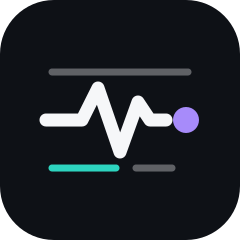

# BlogPulse

**Scan. Read. Rate.**

Every tech blog you care about, checked the moment you open it, sorted by topic, summarised in seconds and ready to share. An iPhone and iPad app for [Scriptable](https://scriptable.app). One file, no server, no sign-up.

  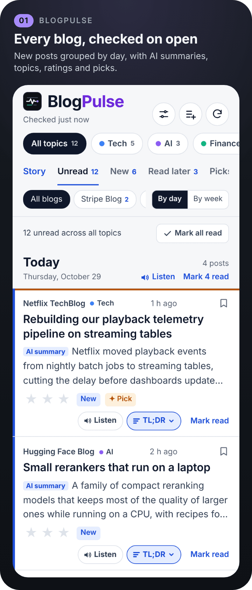
  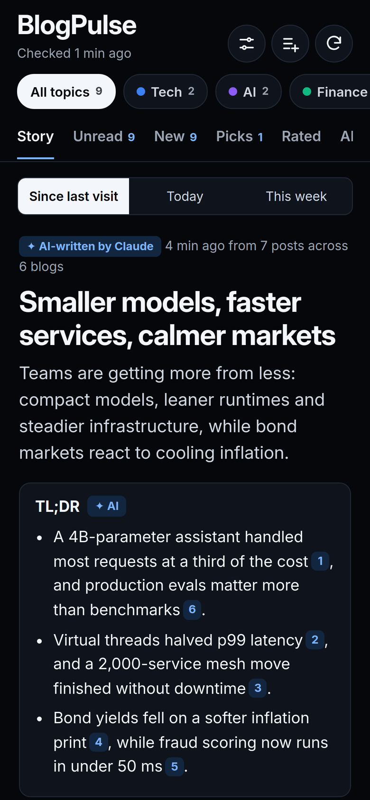
  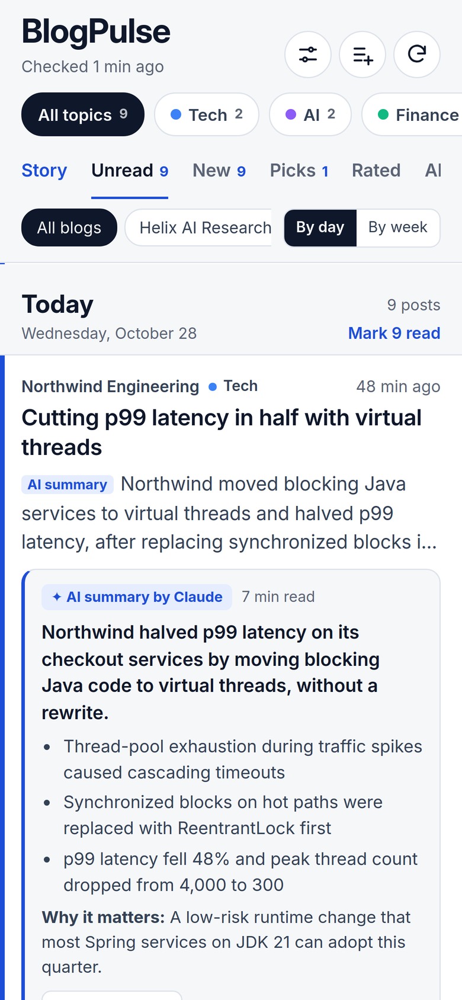

> [!NOTE]
> Screenshots are rendered from the app's real interface with invented sample data. The blog names come from BlogPulse's built-in list of engineering blogs; every post, summary, story and invite shown is invented and was not published by those companies.

> [!IMPORTANT]
> **Independent.** Not affiliated with Feedly or with any blog it reads; posts belong to their publishers. See [Disclaimer](#disclaimer).

## Highlights

- **Checked on open.** Every blog you follow is checked in parallel each time you open BlogPulse. New posts get a blue edge and a **New** tag, grouped by day or by week. Pull the list down and hold to check again, or tap refresh.
- **The Story.** The latest posts blended into one short article with a TL;DR box, "Start with these" picks and numbered links back to every post it draws on. One per topic, for *Since last visit*, *Today* or *This week*.
- **TL;DR in place.** Tap **TL;DR** on any post to see its main point, key facts and why it matters, right in the list. Without AI, the key sentences are extracted from the article itself.
- **Topic pages.** Tech, AI, Finance, Health & Medicine, Science, Fashion & Style and more, filled automatically. Swipe left and right between them, or pin a whole blog to a topic.
- **Invite to read.** Write a short note inviting a colleague to read a post, following your own instructions (tone, length, language), then share it anywhere.
- **Read later.** Tap the bookmark on any post to keep it on the **Read later** tab. Tap **Done** when you've read it, or **Clear finished** to remove every read one.
- **Listen.** Have a day's posts, the Story, a TL;DR or a full article read aloud, with a player that shows progress and time left. Use your iPhone's own voices (free, offline) or a natural **✦ AI voice** from OpenAI.
- **Follow any blog.** Search by name in a built-in list of engineering blogs and Feedly's public directory, or paste any blog address. The RSS or Atom feed is found for you.
- **Ratings and Picks.** Rate posts 1 to 3 stars. **Picks** surfaces unread posts like the ones you rated highest.
- **Made like the other apps.** A launch screen, Settings with six colour themes and every limit on screen, AI on your own Claude or OpenAI key with token usage, a Home Screen widget and one-tap updates, all from the shared [app-blueprints](https://github.com/gadominas/app-blueprints).

## Screenshots

  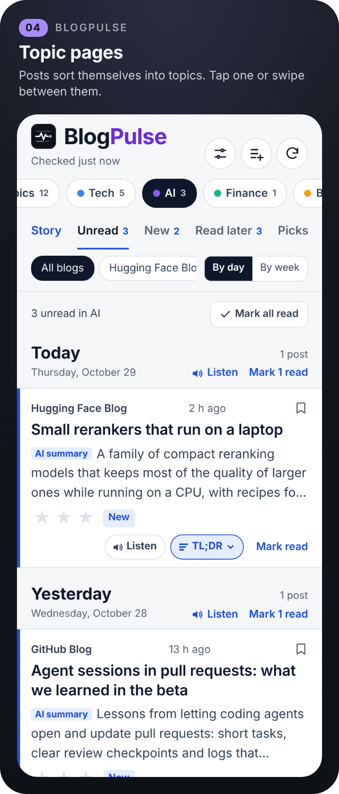
  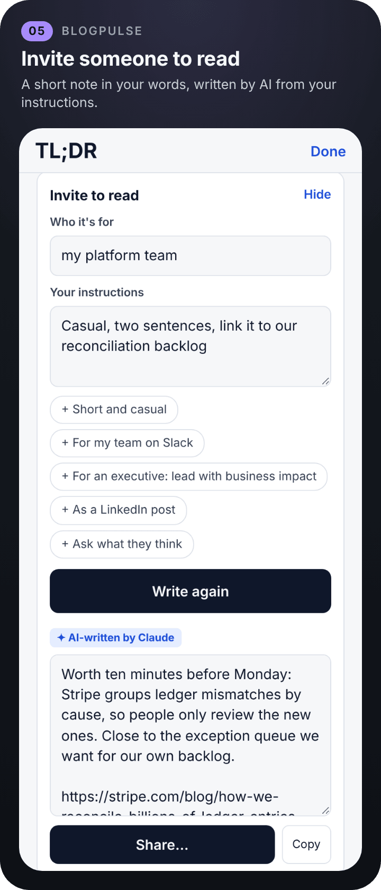
  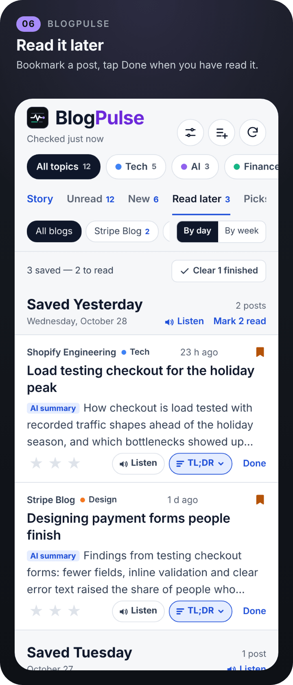

  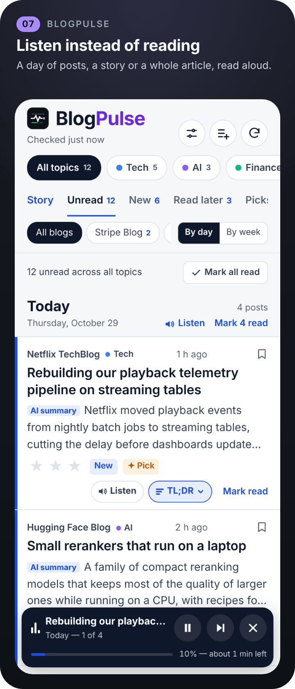
  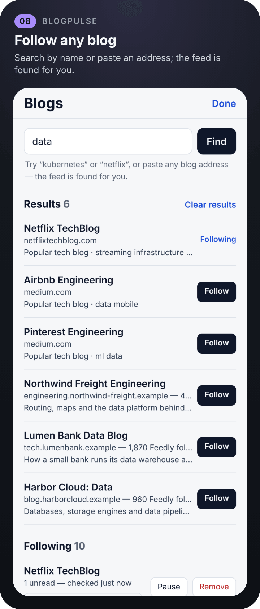
  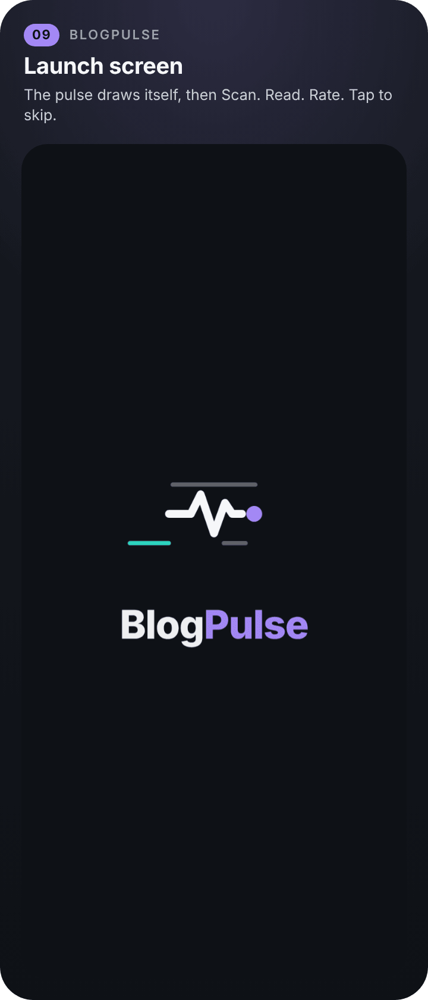

  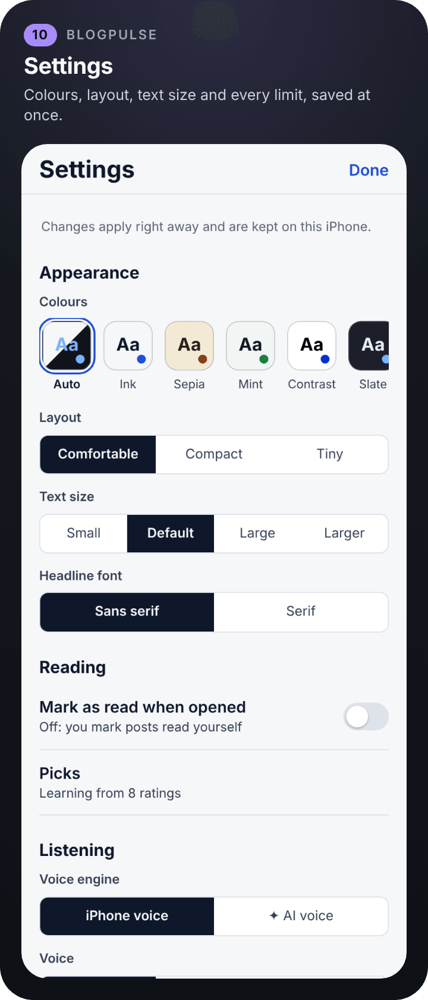
  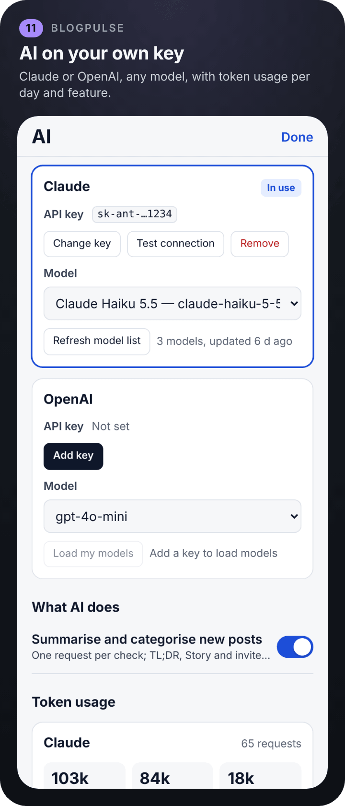
  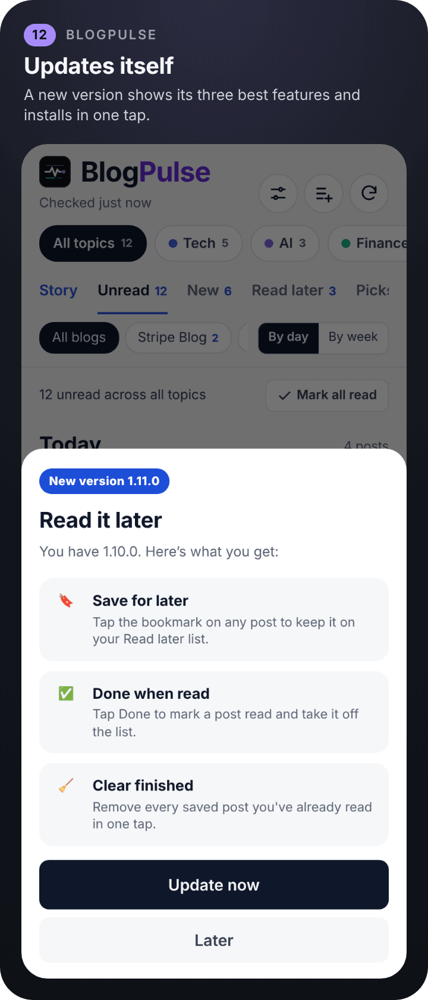

  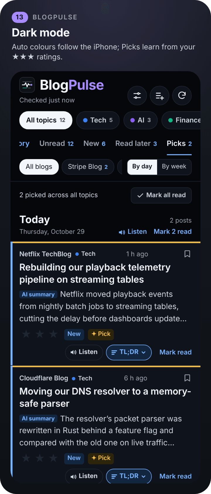
  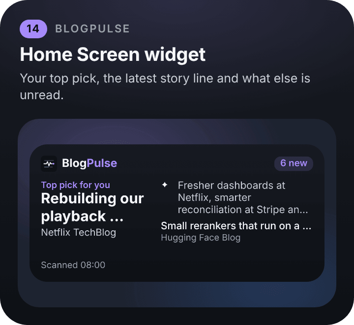

## Install

1. Get **[Scriptable](https://apps.apple.com/app/scriptable/id1405459188)** (free) on your iPhone or iPad.
2. In Scriptable, tap **+**, paste the contents of [`Install BlogPulse.js`](Install%20BlogPulse.js), and tap **Run** (▶).
3. Open **BlogPulse** from your Scripts list and follow your first blogs. A list of popular engineering blogs is waiting for you.

From then on BlogPulse tells you when a new version is out and updates itself with one tap. You can also run the installer again any time; your blogs, posts and settings are kept.

<b>Install by hand</b>

- **Download the file:** save [`BlogPulse.js`](BlogPulse.js) to **iCloud Drive › Scriptable**. It appears in Scriptable automatically.
- **Copy and paste:** in Scriptable, tap **+**, paste the whole of `BlogPulse.js`, and name the script *BlogPulse*.

You need nothing else: no computer, no account, no sign-up. Two optional extras take a minute each:

- **AI:** a [Claude](https://console.anthropic.com/settings/keys) or [OpenAI](https://platform.openai.com/api-keys) API key, added in **Settings › AI settings** (see [AI](#ai)). It switches on the Story, AI TL;DRs, automatic topics and AI-written invites.
- **The widget:** see [Widget](#widget).

## How to use it

| To… | Do this |
|---|---|
| Follow a blog | Tap the add button, search by name or paste an address, then **Follow** |
| See only one topic | Tap a topic at the top, or swipe left or right on the list |
| Read the gist | Tap **TL;DR** on the post |
| Read the whole article | Tap the title |
| Save a post for later | Tap the bookmark on the post. It waits in the **Read later** tab; tap **Done** when you've read it, or **Clear finished** to remove every read one |
| Mark as read | Tap **Mark read**, **Mark N read** next to a day to clear that day, or **Mark all read** at the top of the list to clear the page you're on, after a warning |
| Rate | Tap one, two or three stars. Tap the same star again to clear it |
| Read the Story | Open the **Story** tab and choose *Since last visit*, *Today* or *This week* |
| Listen instead of reading | Tap **Listen** on a post to hear the full article, **Listen** next to a day for its summaries, **Listen to the story**, or **Listen** in a TL;DR. The player at the bottom shows progress and time left; tap the bar to jump, and pause, skip or stop |
| Change the voice | **Settings › Listening**: choose **iPhone voice** or **✦ AI voice**, filter Female or Male, pick a voice, set speed, then **Test the voice** |
| Invite someone to read | Open the TL;DR, tap **Invite to read**, add your instructions, then **Share…** |
| Check for new posts | Pull the list down and hold until the ring fills, or tap refresh |
| Change anything else | Tap **Settings** |

<b>Why BlogPulse instead of Feedly</b>

[Feedly](https://feedly.com) is a capable general-purpose reader. BlogPulse does one job, in the time it takes to drink a coffee: **keep you current with the blogs of the companies you care about, on your phone.**

| | Feedly | BlogPulse |
|---|---|---|
| **Cost** | Free plan; AI (Leo) only on the paid Pro+ plan | Free. AI runs on your own key, and you see every token it uses |
| **How many blogs** | Free plan capped at 100 sources and 3 feeds | No cap |
| **Account** | Feedly account required | None. Nothing to sign up for |
| **Where your data lives** | Feedly's cloud | Your iCloud Drive. Keys stay in the iOS Keychain |
| **AI briefing of what's new** | Pro+ only | **Story**: one short, cited article from your latest posts, for every topic |
| **TL;DR of a post** | Pro+ only | On every post, right in the list. Works without AI too |
| **Sorting** | Folders you maintain by hand | **Topic pages** filled automatically. Swipe between them |
| **Learns what you like** | Leo priorities, Pro+ only | Rate posts 1 to 3 stars; **Picks** finds more like them |
| **Sharing** | Share a link | An **invite to read**, written in your own words, shared with one tap |
| **Choice of AI model** | Feedly's | Any Claude or OpenAI model your key can use |
| **Source code** | Closed | Open, MIT licensed, one file you can read |

Feedly plan details are from its [pricing page](https://feedly.com/i/pro) at the time of writing.

**Easier, because there is less to do:**

- **It opens on what's new.** No inbox to triage: every blog is checked the moment you open the app, and new posts are marked.
- **Three buttons.** Settings, add blogs, refresh, and you can also pull the list down to refresh. Everything else is a tap on the post in front of you.
- **No folders to look after.** Posts land on the right topic page by themselves.
- **Paste any address.** Type a company name or paste a blog's home page; BlogPulse finds the feed.
- **Skim, then decide.** Tap **TL;DR** to read the gist without leaving the list. Open the full article only when it's worth it.

Feedly is still the better pick if you mainly read on a computer, use the web or Android, or need team boards.

## Widget

The widget shows the BlogPulse logo and name, how many posts are new or unread, and your top pick with its blog. The medium widget adds the latest ✦ Story line (when you use AI) or more unread posts beside it; the large one lists up to six rows under it. Tapping a post opens the article; tapping anywhere else opens BlogPulse. When everything is read it says **All caught up**. The bottom line says when your blogs were last checked, and turns amber (**⟳ Updated …**) when that is older than 12 hours. It is the shared [widgets](https://github.com/gadominas/app-blueprints/blob/main/blueprints/widgets.md) blueprint, so all the apps' widgets look alike.

1. Long-press the Home Screen, tap **Edit › Add Widget**, choose **Scriptable** and a size.
2. Long-press the widget, tap **Edit Widget**, set **Script** to *BlogPulse* and **When Interacting** to *Run Script*.

Lock Screen widgets are added the same way under **Customize › Lock Screen**; they show the top pick as text. The widget checks your blogs itself when the last check is older than 30 minutes, within 18 seconds, and otherwise shows what BlogPulse last saved; it never calls AI. You can change these times in **Settings › Widget**.

## AI

AI is optional. With a key, new posts are summarised and sorted into topics in one request per check; the Story, TL;DRs and invites to read run only when you ask for them. Everything AI-written carries a **✦ AI** label, so you always know what you're reading.

- **Your own key.** Open **Settings › AI settings**, add a [Claude](https://console.anthropic.com/settings/keys) or [OpenAI](https://platform.openai.com/api-keys) key, tap **Load my models**, pick any model the key can use and tap **Test connection**. Switch providers any time. For read-aloud, **Settings › Listening › ✦ AI voice** uses OpenAI's speech models; Claude's API has no speech output, so this needs an OpenAI key even when Claude does the writing.
- **Kept safe.** The key is typed into a native iOS prompt, stored in the iOS Keychain and sent only to its own provider. The app's page never sees it.
- **You see the cost.** **AI settings › Token usage** shows tokens per day (a 14-day chart), feature and model. Characters sent for the AI voice are counted as *Read aloud*. API use is billed by Anthropic or OpenAI, separately from any Claude or ChatGPT subscription; a summary costs a small fraction of a cent.
- **Optional.** Without a key everything else works: TL;DRs are extracted from the article (labelled *no AI*), invites use a simple template, posts are sorted by keywords, and the Story tab is hidden.

## Settings

Tap the sliders icon at the top. Changes apply at once and are saved in `settings.json` in iCloud Drive › Scriptable › BlogPulse, so updates never reset them.

| Section | What you can change |
| --- | --- |
| Appearance | Colours (Auto or six palettes), layout (Comfortable, Compact, Tiny), text size, headline font |
| Reading | Mark as read when opened; the Picks status (how many ratings it learns from) |
| Listening | iPhone voice or ✦ AI voice, voice (Female or Male filter), speed, pitch, how an AI voice should sound, Test the voice |
| Updates | Offer new versions, check now, start-up log |
| AI | **AI settings**: keys, models, what AI does and token usage |
| Checking blogs, Keeping posts, Picks, Categories, AI limits, Widget, Invites | Every limit and your invite presets, each with Reset, and Reset all |
| Built with | The shared blueprints this app follows, with links (read-only) |

<b>Every limit and its default</b>

| Section | Setting | Default |
|---|---|---|
| Checking blogs | Time limit per blog | 15 s |
| | Pull-to-refresh hold | 1.5 s |
| | Blogs checked at once | 6 |
| | Browser identity (User-Agent sent to blogs) | an iPhone Safari identity |
| Keeping posts | Keep posts for (rated and saved posts are kept) | 90 days |
| | Keep at most | 2000 posts |
| | New blog backlog (older posts arrive already read) | 3 days |
| | Posts per page | 250 |
| Picks | Ratings before Picks starts | 4 |
| | Picks strictness | 0.8 |
| Categories | Keyword strictness (without AI) | 2.5 |
| AI limits | New posts summarised per check | 25 |
| | Also sort unsorted posts from the last | 14 days |
| | Excerpt kept per post | 600 chars |
| | Article text sent for a TL;DR | 9000 chars |
| | Posts per Story | 40 |
| | "Since last visit" fallback | 2 days |
| Widget | Ask iOS to refresh every | 30 min |
| | Mark the widget as out of date after | 720 min |
| | Widget checks blogs if the last check is older than | 30 min |
| | Time the widget may spend checking | 18 s |
| | Show the AI story summary if newer than | 48 h |
| Invites | Quick instructions (one per line) | Short and casual · For my team on Slack · For an executive: lead with business impact · As a LinkedIn post · Ask what they think |

## Updates and what's new

BlogPulse checks this repository for a new version each time it opens. When one is out, a sheet shows its three best features with **Update now** and **Later**; **Later**, or tapping outside the sheet, hides the offer until you open BlogPulse again. Your data and settings are kept. Every release is in [CHANGELOG.md](CHANGELOG.md). You can also check any time in **Settings › Updates**, or run the installer again.

## Privacy and security

- **Anonymous usage, only if you agree.** A one-time question (and **Settings › Privacy › Share anonymous usage**) decides whether BlogPulse sends anonymous counts to PostHog's US cloud: app opens, blogs checked, posts opened and rated (the star count only), AI summaries and stories made, listening, blogs added and invites written, the app version and a few display settings. Each event carries a random install ID made on your phone, not linked to anything else. Never sent: blogs, post titles, links or text, invite text or names. Turning it off stops sending and deletes the install ID.

- **Everything runs on your phone.** There is no BlogPulse server, and nothing is collected unless you agree to the anonymous usage counts below. Your reading data (blogs, posts, ratings, stories, token counts, settings) is stored as JSON in **iCloud Drive › Scriptable › BlogPulse**.
- **What leaves the phone:** requests to the blogs you follow, Feedly's public feed search when you search by name, and your AI provider. The AI receives post titles and excerpts, and for a TL;DR the article text, only when a feature needs it and only from the provider you chose; the ✦ AI voice sends the text to be spoken to OpenAI.
- AI keys stay in the iOS Keychain and are only sent to their own provider.
- The update check only downloads `releases.json` from this repository.

## How it works

BlogPulse reads the public RSS or Atom feed each blog already publishes. When you paste a website, it looks for the feed the site advertises and then tries the usual addresses. Posts are stored on your phone, sorted into topics by AI or by keyword matching, and shown in a page rendered by Scriptable. The widget is drawn natively by Scriptable from the same data.

BlogPulse follows five shared blueprints: in-app updates, settings, AI configuration, launch screen and widgets. **Settings › Built with** lists them with their versions; [docs/BLUEPRINTS.md](docs/BLUEPRINTS.md) adds the deviations.

## Troubleshooting

| Problem | Try this |
|---|---|
| "No RSS or Atom feed found" | Paste the blog's home page instead of an article, or search by the company's name |
| A blog shows **Last check failed** | The blog may have moved its feed. Remove it and follow it again |
| Posts land on the wrong topic | In the blog list, set that blog to **Always** the right topic |
| The Story tab is missing | It appears once an AI key is saved in **Settings › AI settings** |
| "Key saved, but checking it failed" | The key was rejected or has no credit. Tap **Change key** and paste a valid one |
| The widget shows old posts, or **⟳ Updated …** in amber | Open BlogPulse once; the widget updates from it |
| The voice sounds robotic | Download an Enhanced or Premium voice in iOS Settings › Accessibility › Spoken Content › Voices, then pick it in **Settings › Listening** |
| An update says GitHub is serving the old version | Wait a few minutes after a release and tap **Try again** |
| BlogPulse won't open, or stays on "Loading your posts…" | Swipe Scriptable away to quit it, open it again, and run **Install BlogPulse** once. If it still sticks, the screen shows what it was waiting for, and **Settings › Updates › Start-up log** shows each step of the last openings |

## Built with

- **[Scriptable](https://scriptable.app)** by Simon Støvring: one JavaScript file, a WebView for the interface.
- **[app-blueprints](https://github.com/gadominas/app-blueprints)**: the shared in-app updates, settings, AI configuration, launch screen and widgets that every one of these apps uses, so they look and behave alike. **Settings › Built with** lists the versions; [docs/BLUEPRINTS.md](docs/BLUEPRINTS.md) adds the deviations.
- **Feeds** are the public RSS and Atom feeds each blog publishes; search by name also uses [Feedly](https://feedly.com)'s public feed search. AI by [Anthropic](https://www.anthropic.com) (Claude) or [OpenAI](https://openai.com), on your own key.

Maintainers: release notes live in [`releases.json`](releases.json); see [docs/RELEASING.md](docs/RELEASING.md). Screenshots are regenerated with [repo-site](https://github.com/gadominas/app-blueprints/tree/main/repo-site) from [`docs/site/scenario.js`](docs/site/scenario.js).

## Disclaimer

BlogPulse reads the public RSS and Atom feeds that blogs publish and links to the original posts; posts, names and logos belong to their publishers. AI summaries, TL;DRs and stories can be wrong or leave things out, so check the original post before you rely on it. The blog names in the screenshots come from the app's built-in list; the posts, summaries and stories shown there are invented.

A personal project, provided as is, without warranty. Not affiliated with or endorsed by Feedly, Anthropic, OpenAI or any blog it can follow.

## More apps like this

  &nbsp;
  &nbsp;
  &nbsp;
  &nbsp;
  &nbsp;
  

Strava Daily Digest · BlogPulse · VisionX · Go2FGym · Dienynas+ · Reading Stars, all single-file Scriptable apps built on the same blueprints.

## License

[MIT](LICENSE) © 2026 Gediminas Siutilas. Issues and pull requests are welcome: keep everything in a single Scriptable file, with no build step, and test on a real device. To release, follow [docs/RELEASING.md](docs/RELEASING.md).
