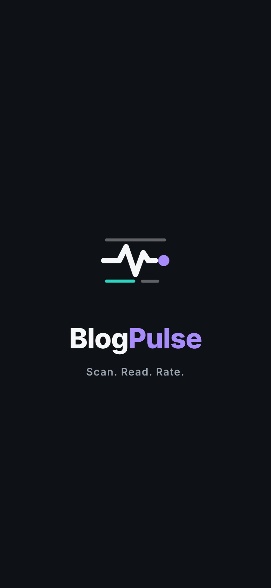
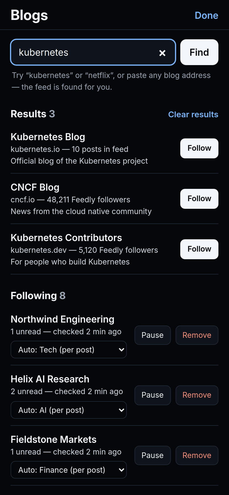
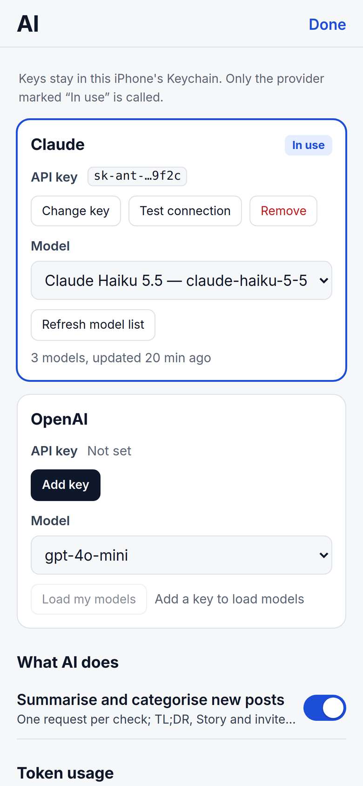
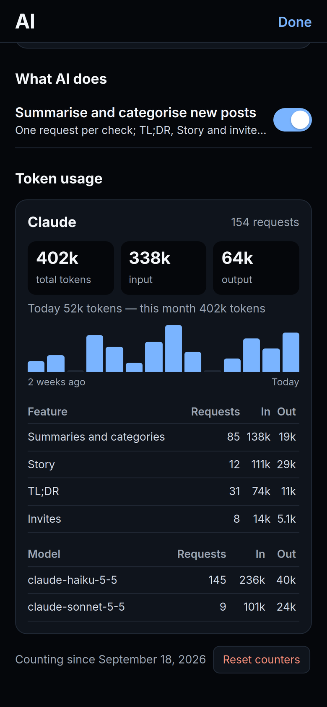
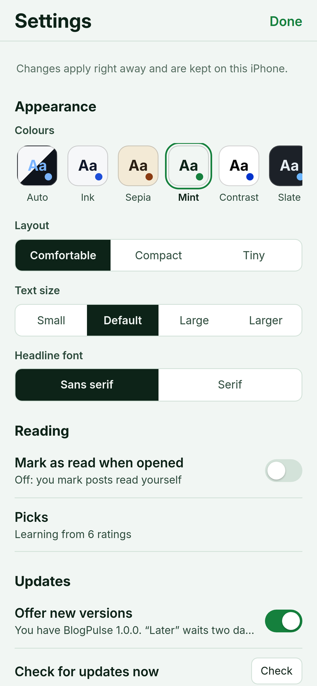
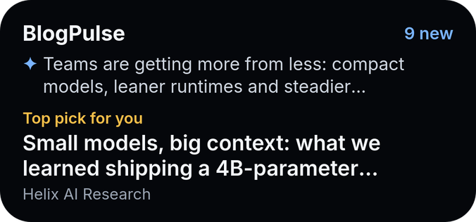
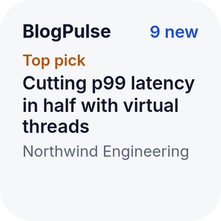
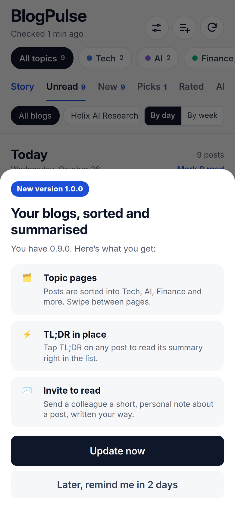

# BlogPulse

**Scan. Read. Rate.**

Every tech blog you care about, checked the moment you open it. Sorted by topic, summarised in seconds, ready to share.

An iPhone and iPad app for [Scriptable](https://scriptable.app). One file. No account, no server, no subscription.

&nbsp;
&nbsp;
&nbsp;

> Screenshots show sample blogs and posts.

## Install in under a minute

You need an iPhone or iPad and the free **[Scriptable](https://apps.apple.com/app/scriptable/id1405459188)** app. Nothing else: no computer, no account, no sign-up.

1. Install **Scriptable** from the App Store and open it.
2. Tap **+**, paste the contents of [`Install BlogPulse.js`](Install%20BlogPulse.js), and tap **Run** (▶).
3. Open **BlogPulse** from your Scripts list and follow your first blogs. A list of popular engineering blogs is waiting for you.

That's it. From now on BlogPulse tells you when a new version is out and updates itself with one tap.

<b>Prefer to install by hand?</b>

- **Download the file:** save [`BlogPulse.js`](BlogPulse.js) to **iCloud Drive › Scriptable**. It appears in Scriptable automatically.
- **Copy and paste:** in Scriptable, tap **+**, paste the whole of `BlogPulse.js`, and name the script *BlogPulse*.

**Two optional extras, each takes a minute:**

- **Add AI:** open **Settings › AI settings**, tap **Add key**, and paste a [Claude](https://console.anthropic.com/settings/keys) or [OpenAI](https://platform.openai.com/api-keys) API key. This switches on the Story, AI TL;DRs, automatic topics and invites to read.
- **Add the widget:** see [Home-screen widget](#home-screen-widget).

## Why BlogPulse instead of Feedly

[Feedly](https://feedly.com) is an excellent general-purpose reader. BlogPulse does one job and does it in the time it takes to drink a coffee: **keep you current with the blogs of the companies you care about, on your phone.**

| | Feedly | BlogPulse |
|---|---|---|
| **Cost** | Free plan; AI (Leo) only on the paid Pro+ plan | Free. AI runs on your own key, and you see every token it uses |
| **How many blogs** | Free plan capped at 100 sources and 3 feeds | No cap |
| **Account** | Feedly account required | None. Nothing to sign up for |
| **Where your data lives** | Feedly's cloud | Your iCloud Drive. Keys stay in the iOS Keychain |
| **AI briefing of what's new** | Pro+ only | **Story**: one short, cited article from your latest posts, for every topic |
| **TL;DR of a post** | Pro+ only | On every post, right in the list. Works without AI too |
| **Sorting** | Folders you maintain by hand | **Topic pages** filled automatically. Swipe between them |
| **Learns what you like** | Leo priorities, Pro+ only | Rate posts 1 to 3 stars; **Picks** finds more like them |
| **Sharing** | Share a link | An **invite to read**, written in your own words, shared with one tap |
| **Choice of AI model** | Feedly's | Any Claude or OpenAI model your key can use |
| **Source code** | Closed | Open, MIT licensed, one file you can read |

Feedly plan details are from its [pricing page](https://feedly.com/i/pro) at the time of writing.

**Easier, because there is less to do:**

- **It opens on what's new.** No inbox to triage: every blog is checked the moment you open the app, and new posts are marked.
- **Three buttons.** Settings, add blogs, refresh, and you can also pull the list down to refresh. Everything else is a tap on the post in front of you.
- **No folders to look after.** Posts land on the right topic page by themselves.
- **Paste any address.** Type a company name or paste a blog's home page; BlogPulse finds the feed.
- **Skim, then decide.** Tap **TL;DR** to read the gist without leaving the list. Open the full article only when it's worth it.

Feedly is still the better pick if you mainly read on a computer, use the web or Android, or need team boards.

## A quick tour

  &nbsp;
  &nbsp;
  

  &nbsp;
  &nbsp;
  

## What you get

| | |
|---|---|
| 🔄 **Checked on open** | Every blog you follow is checked in parallel each time you open BlogPulse. New posts get a blue edge and a **New** tag. Pull the list down and hold to check again, or tap refresh. |
| 🔎 **Follow anything** | Search by name in a built-in list of engineering blogs and Feedly's public directory, or paste any blog address. The RSS or Atom feed is found for you. |
| 🗂 **Topic pages** | Tech, AI, Finance, Health & Medicine, Science, Fashion & Style and more. Swipe left and right between them. Pin a whole blog to a topic if you like. |
| 🧭 **Story** | The latest posts blended into one short article with a TL;DR box, "Start with these" picks, and numbered links back to every post it draws on. One per topic, for *Since last visit*, *Today* or *This week*. |
| ⚡ **TL;DR in place** | Tap **TL;DR** on any post to see its main point, key facts and why it matters, right in the list. Without AI, the key sentences are extracted from the article itself. |
| ✉️ **Invite to read** | Write a short note inviting a colleague to read a post, following your own instructions (tone, length, language), then share it anywhere. |
| 🔊 **Listen** | Have a day's posts, the Story, a TL;DR or a full article read aloud. Use your iPhone's own voices (free, offline) or a natural **✦ AI voice** from OpenAI. Pick a female or male voice, speed and pitch, and for AI voices a style such as "calm newsreader". |
| ⭐ **Ratings and Picks** | Rate posts 1 to 3 stars. **Picks** surfaces unread posts like the ones you loved. |
| 📅 **By day or by week** | Group posts the way you read them, and mark a whole day as read in one tap. |
| 🎨 **Make it yours** | Six colour themes plus Auto (follows light and dark mode), Comfortable, Compact or Tiny layouts, four text sizes, sans or serif headlines. |
| 🎬 **Launch screen** | BlogPulse opens on its logo for 2.4 seconds: the pulse draws itself, then "Scan. Read. Rate." Tap to skip; with Reduce Motion it appears without movement. It is the shared [launch-screen](https://github.com/gadominas/app-blueprints/blob/main/blueprints/launch-screen.md) blueprint, so all the apps start the same way. |
| 🧩 **Built with** | The last section of Settings lists the [shared blueprints](https://github.com/gadominas/app-blueprints) BlogPulse follows, each linked at the exact version used (see [docs/BLUEPRINTS.md](docs/BLUEPRINTS.md)). |
| 🤖 **AI settings** | Claude or OpenAI, any model your key can use, a connection test, and token usage by provider, feature, model and day. |
| ⚙️ **Every setting on screen** | Timeouts, how long to keep posts, Picks strictness, AI limits, widget timing and your invite presets. No code editing. |
| 📲 **Widget** | Your top pick, the latest ✦ Story line and more unread posts on the Home Screen, in the same frame and colours as the other apps' widgets (the shared [widgets](https://github.com/gadominas/app-blueprints/blob/main/blueprints/widgets.md) blueprint). |
| ⬆️ **Updates itself** | When a new version is out, BlogPulse shows its three best features and installs it with one tap. |

## Home-screen widget

  &nbsp;&nbsp;
  

1. Long-press your Home Screen, tap **Edit → Add Widget**, choose **Scriptable**, and pick a size.
2. Long-press the new widget, tap **Edit Widget**, and set **Script** to *BlogPulse*.

The widget shows the BlogPulse logo and name, how many posts are new or unread, and your top pick with its blog. The medium widget adds the latest ✦ Story line (when you use AI) or more unread posts beside it; the large one lists up to six rows under it. Tapping a post opens the article; tapping anywhere else opens BlogPulse. When everything is read it says **All caught up**. The bottom line says when your blogs were last checked, and turns amber (**⟳ Updated …**) when that is older than 12 hours. Lock Screen widgets show the top pick as text.

The widget checks your blogs itself when the last check is older than 30 minutes, within 18 seconds, and otherwise shows what BlogPulse last saved; it never calls AI. You can change these times in **Settings › Widget**.

## AI, on your terms

AI is optional. Without it, everything works, and TL;DRs are extracted from the article.

- **Your key, your choice.** Add a Claude or OpenAI key in **Settings › AI settings**, tap **Load my models**, and pick any model your account can use. Switch providers any time.
- **You see the cost.** Token usage is counted per provider, feature, model and day, with a 14-day chart.
- **Natural voices, too.** Choose **✦ AI voice** in **Settings › Listening** to have posts and the Story read by OpenAI's speech models. Claude's API has no speech output, so this needs an OpenAI key even when Claude does the writing. Characters sent are counted under Token usage as *Read aloud*.
- **It only runs when it helps.** New posts are summarised and sorted in one request per check. The Story, TL;DRs and invites run only when you ask for them.
- **Clearly labelled.** Everything AI-written carries a **✦ AI** label, so you always know what you're reading.

API usage is billed by Anthropic or OpenAI, separately from any Claude or ChatGPT subscription. A summary costs a small fraction of a cent.

## Using it

| To… | Do this |
|---|---|
| Follow a blog | Tap the add button, search by name or paste an address, then **Follow** |
| See only one topic | Tap a topic at the top, or swipe left or right on the list |
| Read the gist | Tap **TL;DR** on the post |
| Read the whole article | Tap the title |
| Mark as read | Tap **Mark read**, **Mark N read** next to a day to clear that day, or **Mark all read** at the top of the list to clear the page you're on, after a warning |
| Rate | Tap one, two or three stars. Tap the same star again to clear it |
| Read the Story | Open the **Story** tab and choose *Since last visit*, *Today* or *This week* |
| Listen instead of reading | Tap **Listen** next to a day, **Listen to the story**, or **Listen** in a TL;DR. Pause, skip or stop from the player at the bottom |
| Change the voice | **Settings › Listening**: choose **iPhone voice** or **✦ AI voice**, filter Female or Male, pick a voice, set speed, then **Test the voice** |
| Invite someone to read | Open the TL;DR, tap **Invite to read**, add your instructions, then **Share…** |
| Check for new posts | Pull the list down and hold until the ring fills, or tap refresh |
| Change anything else | Tap **Settings** |

## Updates and what's new

BlogPulse checks this repository for a newer version each time it opens. If there is one, it shows the three best features and offers **Update now**. **Later**, or tapping outside, hides it until you open BlogPulse again. You can also check any time in **Settings › Updates**, or simply run the installer again.

See [CHANGELOG.md](CHANGELOG.md) for every release. Maintainers: release notes live in [`releases.json`](releases.json); see [docs/RELEASING.md](docs/RELEASING.md).

 

## Privacy and security

- **Everything runs on your phone.** There is no BlogPulse server and nothing is collected.
- **Your reading data** (blogs, posts, ratings, settings) is stored as JSON in **iCloud Drive › Scriptable › BlogPulse**.
- **Your AI keys** are stored in the iOS Keychain and only ever sent to the provider they belong to.
- **What goes to the AI:** post titles and excerpts, and for a TL;DR the article text. Only when a feature needs it, and only to the provider you chose.
- **Network requests** go to the blogs you follow, Feedly's public feed search when you search by name, your AI provider, and this repository for update checks.

## How it works

BlogPulse reads the public RSS or Atom feed each blog already publishes. When you paste a website, it looks for the feed the site advertises and then tries the usual addresses. Posts are stored on your phone, sorted into topics by AI or by keyword matching, and shown in a page rendered by Scriptable. The widget is drawn natively by Scriptable from the same data.

BlogPulse follows four shared blueprints: in-app updates, settings, AI configuration and launch screen. **Settings › Built with** lists them with their versions; [docs/BLUEPRINTS.md](docs/BLUEPRINTS.md) adds the deviations.

## Troubleshooting

| Problem | Try this |
|---|---|
| "No RSS or Atom feed found" | Paste the blog's home page instead of an article, or search by the company's name |
| A blog shows **Last check failed** | The blog may have moved its feed. Remove it and follow it again |
| Posts land on the wrong topic | In the blog list, set that blog to **Always** the right topic |
| The Story tab is missing | It appears once an AI key is saved in **Settings › AI settings** |
| "Key saved, but checking it failed" | The key was rejected or has no credit. Tap **Change key** and paste a valid one |
| The widget shows old posts, or **⟳ Updated …** in amber | Open BlogPulse once; the widget updates from it |
| The voice sounds robotic | Download an Enhanced or Premium voice in iOS Settings › Accessibility › Spoken Content › Voices, then pick it in **Settings › Listening** |
| An update says GitHub is serving the old version | Wait a few minutes after a release and tap **Try again** |

## Contributing

Issues and pull requests are welcome. Keep everything in a single Scriptable file, with no build step, and test on a real device. To release, follow [docs/RELEASING.md](docs/RELEASING.md).

## License

[MIT](LICENSE) © 2026 Gediminas Siutilas
